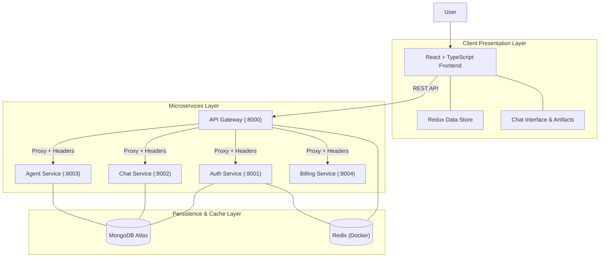
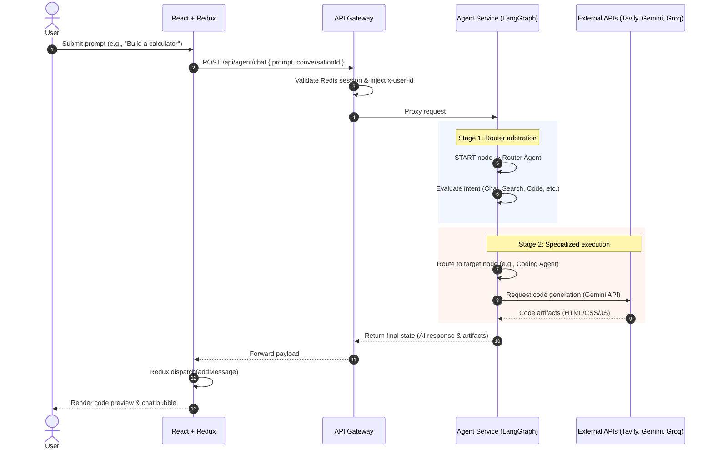
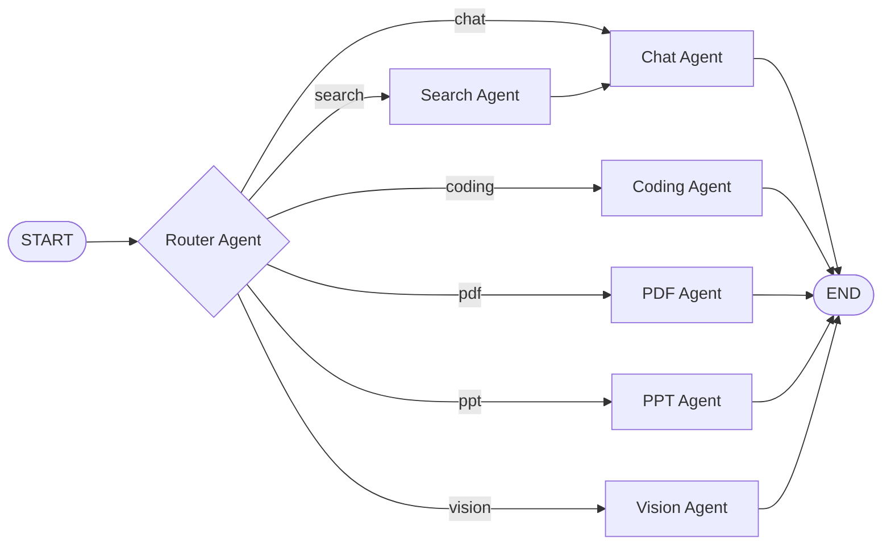

<div align="center">

# Aviora AI

### A Microservices-Driven, Multi-Agent AI Platform

Intent-aware routing to specialized agents for **Chat, Search, Code, PDF, PPT and Vision** — built on LangGraph, Express microservices and a Redux-powered React frontend.


[Repository](https://github.com/RythemSood1709/Intesa_AI) · [Report a Bug](https://github.com/nigam-divyanshi-dev/AvioraAI/issues) · [Request a Feature](https://github.com/nigam-divyanshi-dev/AvioraAI/issues)

</div>

---

**Aviora AI** is a scalable multi-agent platform that orchestrates specialized AI tasks across distributed backend services.

Instead of pushing every request through one monolithic LLM prompt, Aviora AI uses a **LangGraph workflow** to interpret user intent and route each query to a purpose-built agent. A centralized API Gateway, isolated microservices and Redux-managed frontend state keep the system modular, fast and easy to reason about.

> **Core principle:** Specialized intelligence through distributed agents. Scalability through microservices. Predictable state management.

---

## Table of Contents

- [Key Features](#key-features)
- [How Aviora AI Works](#how-aviora-ai-works)
- [System Architecture & Data Flow](#system-architecture--data-flow)
  - [High-Level Architecture](#high-level-architecture)
  - [Frontend State Management](#frontend-state-management)
  - [Multi-Agent Execution Sequence](#multi-agent-execution-sequence)
- [The LangGraph Pipeline & Agent Responsibilities](#the-langgraph-pipeline--agent-responsibilities)
- [API Reference](#api-reference)
- [Technology Stack](#technology-stack)
- [Service Responsibilities](#service-responsibilities)
- [Repository Structure](#repository-structure)
- [Quick Start with Docker Compose](#quick-start-with-docker-compose)
- [Local Native Development Setup](#local-native-development-setup)
- [Troubleshooting](#troubleshooting)
- [Design Principles](#design-principles)
- [Project Status](#project-status)
- [Roadmap](#roadmap)
- [Contributing](#contributing)
- [License](#license)

---

## Key Features

| Feature | Description |
| --- | --- |
| **Intelligent multi-agent routing** | LangGraph evaluates each prompt and dispatches it to the right agent instead of a generic chat model. |
| **Microservices architecture** | Isolated Auth, Chat, Agent and Billing services behind a single Express.js API Gateway. |
| **High-performance caching** | Redis (via Docker) handles session management and temporary data across services. |
| **Centralized state management** | Redux Toolkit manages cross-component state without prop drilling. |
| **Interactive coding artifacts** | Generated code is previewed and executed live inside the chat interface. |
| **Integrated billing** | Razorpay integration for credit purchases and subscription plans. |
| **Multi-modal outputs** | Web code, downloadable PDFs, PowerPoint decks and AI-generated images. |

---

## How Aviora AI Works

1. **Authentication & session initiation:** Users sign in with Firebase / Google Auth. The backend verifies the token, creates a user profile in MongoDB and caches the active session in Redis.
2. **Query submission:** The user submits a prompt from the React frontend. Redux immediately updates local state to show a loading indicator.
3. **Gateway routing:** The prompt reaches the API Gateway (`:8000`), which validates the Redis session, injects an `x-user-id` header and proxies the request to the Agent Service (`:8003`).
4. **Intent arbitration (Router node):** The LangGraph Router Agent classifies the prompt and selects the appropriate specialized agent.
5. **Specialized execution:** The chosen agent (Search, Coding, PDF, etc.) runs its own logic using the right LLM (Groq, Gemini) and tools (Tavily).
6. **Response & audit:** The result returns through the Gateway to the frontend, where Redux dispatches it to the UI and the message history is persisted to the database.

---

## System Architecture & Data Flow

Aviora AI separates the presentation layer, API routing, microservice execution and state persistence.

### High-Level Architecture

The frontend never talks to backend services directly. Every request goes through the API Gateway on port `8000`, which distributes traffic to the isolated microservices.



### Frontend State Management

Redux Toolkit keeps the UI state synchronized and predictable. A central store holds distinct slices (`UserSlice`, `ChatSlice`, `ConversationSlice`), so components like the Navbar, Home and Chat UI stay in sync without manual prop drilling.

<!-- Add your Redux data-flow diagram here, e.g.:

-->

### Multi-Agent Execution Sequence

How a single query traverses the LangGraph pipeline:



---

## The LangGraph Pipeline & Agent Responsibilities

Intelligence is partitioned across specialized nodes in a custom LangGraph workflow. When a prompt enters the `START` state, the **Router Agent** decides the execution path.



| # | Agent | Role | Model / Tools |
| --- | --- | --- | --- |
| 1 | **Router** | The traffic cop. Uses a fast LLM to classify intent and emit a single routing keyword (`chat`, `search`, `coding`, `pdf`, `ppt`, `vision`) mapped to a conditional edge. | Groq |
| 2 | **Chat** | Handles general conversation, explanations and greetings. Uses conversation history fetched from Redis for context. | Groq |
| 3 | **Search** | Triggers when real-time data is needed. Fetches current events, links and images via Tavily, then hands the processed data to the Chat Agent for final synthesis. | Tavily |
| 4 | **Coding** | Writes, reviews and debugs code. Returns structured artifacts that the frontend renders in a live preview window. | Gemini |
| 5 | **Document (PDF & PPT)** | Formats responses into downloadable assets: `.pdf` files and `.pptx` decks. Outputs are stored temporarily in AWS S3. | AWS S3 |
| 6 | **Vision (Image)** | Connects to image-generation models to turn text descriptions into downloadable image URIs. | Image generation model |

---

## API Reference

### API Gateway (`http://localhost:8000`)

All frontend requests target the Gateway, which maps them to internal services via `/api/<service_name>/...`.

| Method | Endpoint | Internal Route | Description |
| --- | --- | --- | --- |
| `POST` | `/api/auth/login` | `http://localhost:8001/login` | Verifies the Google/Firebase token, syncs MongoDB, creates a Redis session. |
| `POST` | `/api/auth/logout` | `http://localhost:8001/logout` | Destroys the Redis session and clears HTTP-only cookies. |
| `GET` | `/api/chat/conversations` | `http://localhost:8002/conversations` | Fetches conversation history for the authenticated user. |
| `GET` | `/api/chat/messages/:id` | `http://localhost:8002/messages/:id` | Retrieves all messages for a conversation ID. |
| `POST` | `/api/agent/chat` | `http://localhost:8003/chat` | Invokes the LangGraph pipeline with the user's prompt. |
| `POST` | `/api/billing/upgrade` | `http://localhost:8004/upgrade` | Initiates Razorpay checkout for credit purchases. |

**Example request**

```bash
curl -X POST http://localhost:8000/api/agent/chat \
  -H "Content-Type: application/json" \
  --cookie "<session-cookie>" \
  -d '{ "prompt": "Build a calculator", "conversationId": "abc123" }'
```

> All protected routes require a valid Redis-backed session cookie. The Gateway injects `x-user-id` for downstream services.

---

## Technology Stack

| Layer | Technology |
| --- | --- |
| Frontend | React, Redux Toolkit, Tailwind CSS, Vite |
| Backend core | Node.js, Express.js (microservices) |
| AI orchestration | LangChain.js, LangGraph |
| LLM providers | Groq (Chat/Router), Google Gemini (Coding/complex tasks) |
| Search | Tavily API |
| Database | MongoDB Atlas |
| Caching / sessions | Redis (Dockerized) |
| Auth | Firebase / Google OAuth |
| Billing & payments | Razorpay |
| Cloud storage | AWS S3 (generated PDFs/images) |

---

## Service Responsibilities

### Frontend (`frontend/`)
- Render the chat interface, dynamic sidebars and interactive coding artifacts.
- Manage global state with Redux Toolkit slices (`UserSlice`, `ChatSlice`, `ConversationSlice`).
- Handle Google OAuth popups and send secure tokens to the backend.

### API Gateway (`backend/gateway/`)
- Single entry point for all client requests.
- Resolve CORS.
- Verify Redis session cookies and append the `x-user-id` header before proxying.

### Microservices (`backend/services/`)

| Service | Port | Responsibility |
| --- | --- | --- |
| **Auth** | `8001` | JWT validation, Firebase admin tasks, MongoDB user creation. |
| **Chat** | `8002` | CRUD for conversations and message persistence. |
| **Agent** | `8003` | The AI brain. Runs the LangGraph workflow in JS/TS via LangChain.js. |
| **Billing** | `8004` | Razorpay checkout and credit/subscription handling. |
| **Shared** (`backend/shared/`) | n/a | Local package with cross-service utilities such as the Redis connection singleton and common error handlers. |

---

## Repository Structure

```text
AvioraAI/
├── frontend/
│   ├── package.json
│   ├── vite.config.js
│   └── src/
│       ├── components/      # UI components (Sidebar, ChatArea, Artifacts, MessageBubble)
│       ├── features/        # API call implementations (Axios setups)
│       └── redux/           # Store configuration and slices (User, Chat)
│
├── backend/
│   ├── gateway/             # API Gateway (Express proxy)
│   │   ├── index.js
│   │   └── middleware/      # Auth validation & proxy configuration
│   │
│   ├── shared/              # Logic shared across microservices
│   │   └── redis.js         # Centralized Redis connection instance
│   │
│   └── services/
│       ├── auth/            # Authentication Service (:8001)
│       │   ├── controllers/
│       │   ├── models/      # Mongoose User schema
│       │   └── routes/
│       │
│       ├── chat/            # Chat & History Service (:8002)
│       │   ├── controllers/
│       │   ├── models/      # Mongoose Conversation & Message schemas
│       │   └── routes/
│       │
│       ├── agent/           # LangGraph AI Service (:8003)
│       │   ├── agents/      # Agent implementations (Search, Code, PDF, ...)
│       │   ├── graph/       # LangGraph state definition & workflow compilation
│       │   └── controllers/
│       │
│       └── billing/         # Razorpay Integration Service (:8004)
│
├── docker-compose.yml       # Redis & infrastructure container orchestration
├── .env.example
└── README.md
```

---

## Quick Start with Docker Compose

Docker Compose currently runs the backing cache infrastructure (Redis).

**1. Clone the repository**

```bash
git clone https://github.com/nigam-divyanshi-dev/AvioraAI.git
cd Aviora_AI
```

**2. Start Redis**

```bash
docker-compose up -d
```

This starts a Redis container on port `6379`, used for session management and rate limiting.

**3. Verify the container**

```bash
docker ps
```

Expected output:

```text
CONTAINER ID   IMAGE     COMMAND                  PORTS                    NAMES
a1b2c3d4e5f6   redis     "docker-entrypoint.s…"   0.0.0.0:6379->6379/tcp   aviora-redis
```

---

## Local Native Development Setup

### 1. Prerequisites

- **Node.js 18+** (`node -v`)
- **Docker Desktop** (for Redis)
- **MongoDB Atlas** connection URI
- API keys for **Groq**, **Google Gemini** and **Tavily**
- A **Firebase** project (Google sign-in enabled) and a **Razorpay** account for billing

### 2. Configure environment variables

Copy `.env.example` to `.env` in the root of **each** microservice, the gateway and the frontend:

| Variable | Purpose |
| --- | --- |
| `MONGO_URI` | MongoDB Atlas connection string |
| `REDIS_URL` | Redis connection (e.g., `redis://localhost:6379`) |
| `FIREBASE_ADMIN_CREDENTIALS` | Firebase Admin service account credentials |
| `GROQ_API_KEY` | Groq LLM access (Chat/Router) |
| `GEMINI_API_KEY` | Google Gemini access (Coding/complex tasks) |
| `TAVILY_API_KEY` | Tavily web search |

> Never commit `.env` files or credentials to version control.

### 3. Start backend services

Run each in its own terminal:

```bash
# Gateway
cd backend/gateway && npm install && npm run dev

# Auth Service
cd backend/services/auth && npm install && npm run dev

# Chat Service
cd backend/services/chat && npm install && npm run dev

# Agent Service
cd backend/services/agent && npm install && npm run dev

# Billing Service (optional, needed for payments)
cd backend/services/billing && npm install && npm run dev
```

### 4. Start the frontend

```bash
cd frontend
npm install
npm run dev
```

Open **http://localhost:5173**.

---

## Troubleshooting

| Symptom | Likely cause / fix |
| --- | --- |
| `ECONNREFUSED 6379` | Redis isn't running. Run `docker-compose up -d`. |
| `401 Unauthorized` from the Gateway | Session expired or cookie missing. Log in again. |
| CORS errors in the browser | Make sure the frontend runs on `http://localhost:5173` and requests go to the Gateway (`:8000`), not directly to a service. |
| Agent returns empty/failed responses | Check `GROQ_API_KEY`, `GEMINI_API_KEY` and `TAVILY_API_KEY` in the Agent Service `.env`. |
| MongoDB connection timeout | Whitelist your IP in MongoDB Atlas network access. |

---

## Design Principles

**Modularity over monoliths.** With separate services, a failure in billing or chat does not take down the core AI agent pipeline.

**Specialized intelligence.** Generic prompts struggle with complex tasks. Intesa AI delegates distinct needs, such as code generation versus web search, to tool-specific agents.

**Centralized, predictable state.** Prop drilling causes UI bugs in complex React apps. All critical UI state flows one way through Redux Toolkit.

---

## Project Status

| Area | Status | Notes |
| --- | --- | --- |
| Microservices scaffolding & Gateway | ✅ Completed | Proxies correctly append `x-user-id`. |
| Firebase & Redis auth flow | ✅ Completed | Sessions are stored and invalidated correctly. |
| React UI & Redux Toolkit integration | ✅ Completed | Sidebar, Chat Area and slices fully operational. |
| MongoDB chat history schemas | ✅ Completed | Messages and conversations mapped. |
| LangGraph Router orchestration | ✅ Completed | Routes between Auto, Chat and Search. |
| Search Agent (Tavily) | ✅ Completed | Returns web context and image URIs. |
| Coding Agent & UI artifacts | ✅ Completed | Generates HTML/JS with live interactive preview. |
| Document Agents (PDF/PPT) | 🚧 In progress | S3 bucket integration under testing. |
| Razorpay Billing Service | ✅ Completed | Mock endpoints verified. |
| Vision (Image) Agent | 📝 Planned | Routing defined; model integration pending. |

---

## Roadmap

- [ ] Finish S3 integration for PDF/PPT generation
- [ ] Wire up the Vision Agent to an image-generation model
- [ ] Containerize all services in `docker-compose.yml`
- [ ] Add automated tests and CI (lint + test on pull requests)
- [ ] Streaming responses for chat and code generation
- [ ] Rate limiting and usage analytics per user

---

## Contributing

Contributions are welcome.

1. Fork the repository
2. Create a feature branch: `git checkout -b feature/your-feature`
3. Commit your changes: `git commit -m "Add your feature"`
4. Push the branch: `git push origin feature/your-feature`
5. Open a Pull Request

For bugs and ideas, please [open an issue](https://github.com/nigam-divyanshi-dev/AvioraAI/issues).

---

## License

Add a `LICENSE` file to the repository (e.g., MIT) and reference it here.

---

<div align="center">

Built by [Divyanshi Nigam](https://github.com/nigam-divyanshi-dev)

</div>